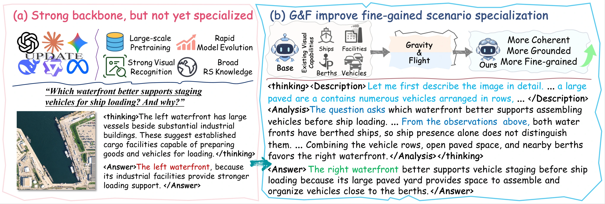
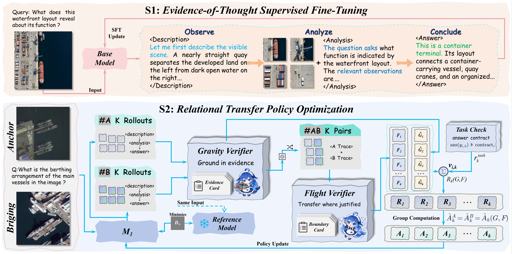
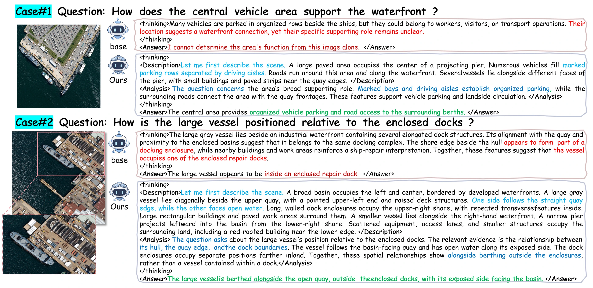
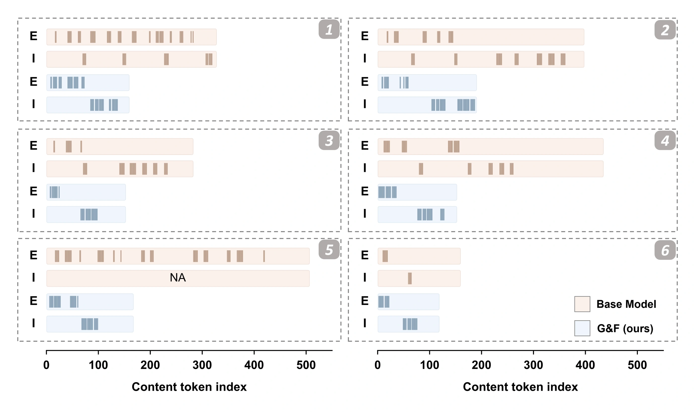

# Gravity & Flight

### Evidence-grounded reasoning for fine-grained remote sensing.

<em>“Flight is not the absence of gravity, but the art of working within its constraints.”</em>

  
  &nbsp;
  
  &nbsp;
  
  &nbsp;
  

<strong>English</strong> · <a href="README_zh.md">简体中文</a>

<a href="#overview">Overview</a> &nbsp;·&nbsp; <a href="#method">Method</a> &nbsp;·&nbsp; <a href="#reported-results">Results</a> &nbsp;·&nbsp; <a href="#resources">Resources</a>

*Recognizing ships and facilities is a starting point. This illustrative example asks the model to connect vehicle rows, paved space, and nearby berths to the task. Both waterfronts are in one input image.* [Original PDF](web/assets/papers/gf-motivation.pdf)

## Overview

Gravity and Flight (G&F) adapts **Qwen3.5-4B** through two stages of post-training. It teaches the model to connect detailed observations to task-specific judgments, then refine those judgments when the evidence changes.

| Backbone | Supervision | Overall |
| :---: | :---: | :---: |
| **4B** Qwen3.5 One image | **1,008 demos** **500 pairs** Two stages | **69.12** +9.76 vs. Base |

## Research idea

[Filling Before Advancing (FBA)](https://github.com/Z0ngL1ng/filling-before-advancing) develops capabilities for remote-sensing scenario specialization. Its second stage, **Bridging-Conv**, learns shared priors across target and related scenes. G&F takes that idea into finer contextual changes **within one scene domain**: which judgments should change, stay consistent, or become less specific as local attributes, spatial relations, and visibility vary?

<strong>Related work · Filling Before Advancing</strong>

[Zong et al. (2026), *Filling Before Advancing*](https://arxiv.org/abs/2607.22205)

| Paper | Project | Model | Dataset |
| :---: | :---: | :---: | :---: |
| [arXiv](https://arxiv.org/abs/2607.22205) | [Website](https://z0ngl1ng.github.io/filling-before-advancing/) | [HF preview](https://huggingface.co/zongling/FBA) | [CPRS preview](https://huggingface.co/datasets/zongling/CPRS) |

The name draws on gravity and aerodynamic lift. **Gravity** anchors visual claims to the image; **Flight** evaluates reasoning from described observations. The analogy motivates complementary verification, not a physical reward model.

## Method

*The complete method figure from the paper.* [Original PDF](web/assets/papers/gf-method.pdf)

1. **EoT-SFT** initializes a description → analysis → answer process with 1,008 harbor demonstrations covering 888 images.
2. **RTPO** refines this process using 500 Anchor–Bridging pairs under shared tasks. Responses are generated independently for each image, then randomly matched one-to-one for verification.

Gravity checks visual fidelity and descriptive coverage. Flight checks evidence use and justified adaptation across the pair. Task Check evaluates final-answer correctness. Their scores form an **additive pair reward and a shared advantage**; Gravity does not gate Flight. Flight does not inspect images or receive answer contracts. [Verification details](docs/RESEARCH.md#complementary-verification)

> **Inference uses one image and one question.** Paired supervision and verification cards are training machinery, not policy inputs at deployment.

## Reported results

G&F reaches **69.12 Overall**, gaining **9.76 points over Base** and **4.56 points over EoT-SFT**.

| Checkpoint | Overall | Δ vs. Base |
| --- | ---: | ---: |
| Qwen3.5-4B Base | 59.36 | — |
| EoT-SFT | 64.56 | +5.20 |
| Single-image RL | 65.12 | +5.76 |
| Paired RL without F2 | 66.79 | +7.43 |
| **G&F** | **69.12** | **+9.76** |

Overall is the unweighted mean of six harbor evaluation-set scores: HarborEval, VRSBench, RSVQA, OpenEval, OmniEarth, and VLRS-Bench. Each retains its own scoring protocol; this is a study-specific aggregate, not pooled accuracy or a full-benchmark leaderboard. [Full comparison, ablations, and separate urban study](docs/RESEARCH.md#harbor-evaluation)

The paired formulation without F2 gains **1.67 points** over single-image RL; adding aligned F2 feedback adds **2.33 points**. Shuffling computed F2 scores among the six candidate pairs within each training unit gives **64.71**, while joint-input RL gives **66.49**. Full G&F uses **16.69×** the measured Stage-1 wall time, including initialization and verifier waiting. [All controls and measured costs](docs/RESEARCH.md#ablations-and-controls)

<strong>Verifier reliability</strong> — 24 sampled training units

| Dimension | Items | Within one point of humans (%) | Repeat-change rate (%) |
| --- | ---: | ---: | ---: |
| G1 | 48 | 91.67 | 22.92 |
| G2 | 48 | 100.00 | 12.50 |
| F1 | 48 | 89.58 | 27.08 |
| F2 | 24 | 83.33 | 29.17 |

24 sampled training units; two independent annotators with adjudication. Agreement compares the first judge call with the human reference. Repeat-change counts any score difference across two identical calls. This small audit indicates reliability; it does not validate the rubric itself. [Audit protocol](docs/RESEARCH.md#verifier-reliability)

<strong>Two qualitative cases</strong> — local evidence and spatial relations

These examples illustrate how local observations support a task-specific conclusion: organized vehicle parking and road access in the first case, and alongside berthing outside enclosed docks in the second. They are qualitative examples, not an aggregate accuracy estimate. [Original PDF](web/assets/papers/gf-qualitative-cases.pdf)

<strong>Six-case response analysis</strong> — evidence and inference token positions

**E** marks evidence tokens; **I** marks inference tokens. Warm rows show Base and cool rows show G&F. **NA** denotes a Base response with no analytical tokens, rather than zero inference density.

The horizontal axis counts content tokens, excluding format-only tokens. Across six sampled image–question cases, mean content length is **350.83 → 156.33 tokens**, and mean task-related content density is **22.35% → 39.91%**. This descriptive sample does not establish benchmark-wide efficiency or accuracy. [Analysis definitions](docs/RESEARCH.md#response-analysis) · [Original PDF](web/assets/papers/gf-token-analysis.pdf)

## Resources

| Resource | Entry | Current availability |
| --- | --- | --- |
| **Project website** | [Explore G&F](https://z0ngl1ng.github.io/Gravity-and-Flight/) | Research story, figures & results |
| **4B model** | [Hugging Face model page](https://huggingface.co/zongling/Gravity_and_Flight-4B) | Model card published |
| **Dataset preview** | [Overview](https://huggingface.co/datasets/zongling/Gravity_and_Flight-2K) · [Stage 1](https://huggingface.co/datasets/zongling/Gravity_and_Flight-2K/tree/main/stage1) · [Stage 2](https://huggingface.co/datasets/zongling/Gravity_and_Flight-2K/tree/main/stage2) | 3 demonstrations + 3 image pairs |
| **Research notes** | [Method & reported experiments](docs/RESEARCH.md) | Definitions, controls & study scope |
| **Release status** | [Follow artifact releases](RELEASE_STATUS.md) | Availability and planned updates |

**Model weights and the full dataset are planned for staged release after paper acceptance.** The full manuscript and training/evaluation implementation remain unreleased.

Website source, figure provenance & documentation

- [Website source](web/) and [local preview instructions](docs/WEBSITE.md#view-the-website)
- [Four original paper figures and source mapping](docs/FIGURES.md)
- [License scope](LICENSE_SCOPE.md)

