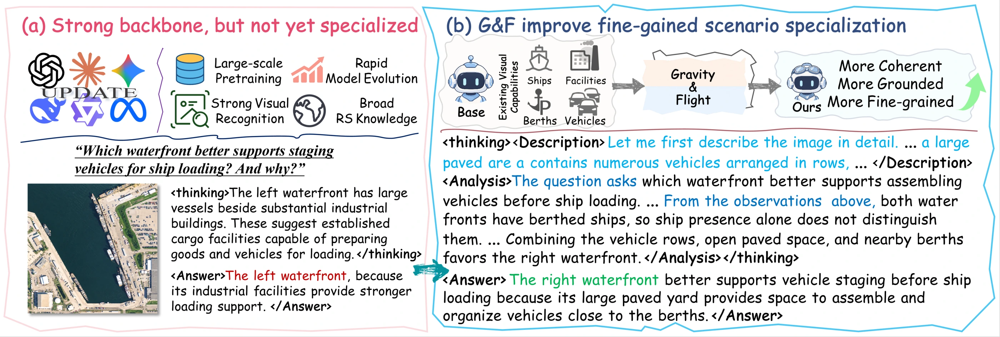
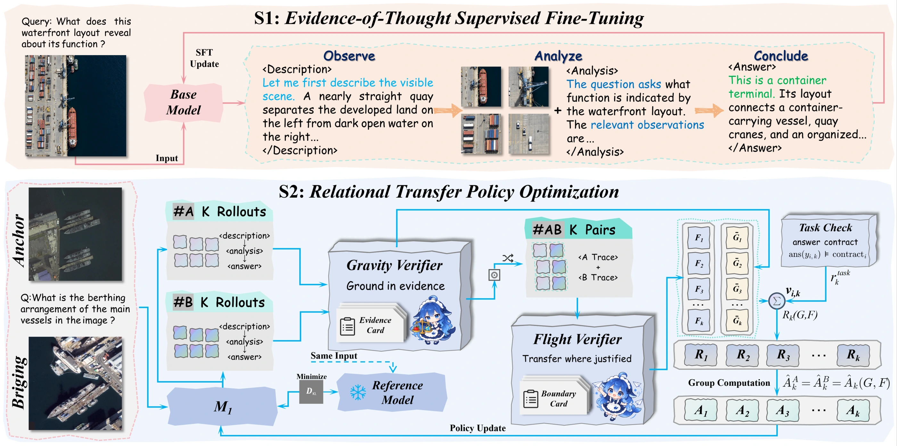

<div align="center">

# Gravity & Flight

### Evidence-grounded reasoning for fine-grained remote sensing.

<p align="center"><em>“Flight is not the absence of gravity, but the art of working within its constraints.”</em></p>

<p align="center">
  <a href="https://arxiv.org/abs/2611.16408"></a>
  &nbsp;
  <a href="https://z0ngl1ng.github.io/Gravity-and-Flight/web/"></a>
  &nbsp;
  <a href="https://huggingface.co/zongling/Gravity_and_Flight-4B"></a>
  &nbsp;
  <a href="https://huggingface.co/datasets/zongling/Gravity_and_Flight-2K"></a>
</p>

<p align="center"><strong>English</strong> · <a href="README_zh.md">简体中文</a></p>

</div>

## Overview

Gravity and Flight (G&F) teaches **Qwen3.5-4B** to connect detailed observations to task-specific judgments, then refine those judgments when the evidence changes.

[Filling Before Advancing (FBA)](https://github.com/Z0ngL1ng/filling-before-advancing) develops capabilities for remote-sensing scenario specialization. Its second stage, **Bridging-Conv**, learns shared priors across target and related scenes. G&F takes that idea into finer contextual changes **within one scene domain**: which judgments should change, stay consistent, or become less specific as local evidence varies?



*Illustrative harbor case; both waterfronts are in one input image.*

## Method



1. **EoT-SFT** initializes a description → analysis → answer process with 1,008 harbor demonstrations covering 888 images.
2. **RTPO** refines this process using 500 Anchor–Bridging pairs under shared tasks. Responses are generated independently for each image, then randomly matched one-to-one for verification.

The name draws on gravity and aerodynamic lift. **Gravity** anchors visual claims to the image; **Flight** checks evidence use and justified adaptation across paired responses. **Task Check** evaluates final-answer correctness. [Verification details](docs/RESEARCH.md#complementary-verification)

> **Inference uses one image and one question.**

## Reported results

| Checkpoint | Overall | Δ vs. Base |
| --- | ---: | ---: |
| Qwen3.5-4B Base | 59.36 | — |
| EoT-SFT | 64.56 | +5.20 |
| **G&F** | **69.12** | **+9.76** |

Overall is the unweighted mean of six harbor evaluation-set scores. Each retains its own scoring protocol; this is a study-specific aggregate, not pooled accuracy or a full-benchmark leaderboard.

## Resources

| Resource | Entry |
| --- | --- |
| **Paper** | [Gravity and Flight: Learning to Navigate Fine-Grained Remote Sensing Scenes](https://arxiv.org/abs/2611.16408) |
| **Research notes** | [Method, reported experiments & study scope](docs/RESEARCH.md) |
| **Dataset samples** | [Stage 1](https://huggingface.co/datasets/zongling/Gravity_and_Flight-2K/tree/main/stage1) · [Stage 2](https://huggingface.co/datasets/zongling/Gravity_and_Flight-2K/tree/main/stage2) · 3 demonstrations + 3 image pairs |
| **Release status** | [Follow artifact releases](RELEASE_STATUS.md) |
| **Documentation** | [Website source](web/) · [Local preview](docs/WEBSITE.md#view-the-website) · [Paper figures](docs/FIGURES.md) · [License scope](LICENSE_SCOPE.md) |

**Model weights and the full dataset are planned for staged release after paper acceptance.** The training and evaluation code is not yet public.

<details>
<summary><strong>Related work · Filling Before Advancing</strong></summary>

Zong et al. (2026), *Filling Before Advancing*.

| Paper | Project | Model | Dataset |
| :---: | :---: | :---: | :---: |
| [arXiv](https://arxiv.org/abs/2607.22205) | [Website](https://z0ngl1ng.github.io/filling-before-advancing/) | [HF preview](https://huggingface.co/zongling/FBA) | [CPRS preview](https://huggingface.co/datasets/zongling/CPRS) |

</details>

## Citation

FBA and G&F form a research line on remote sensing scene specialization. The BibTeX entries for both papers are provided below.

### Filling Before Advancing (FBA)

```bibtex
@article{zong2026fba,
  title   = {Filling Before Advancing: Capability-Gap-Driven Post-Training for Scenario-Specialized Remote Sensing {MLLMs}},
  author  = {Zong, Yuheng and Wang, Minghua and Zhao, Xin and Zhan, Zhi-Hui and Plaza, Antonio and Benediktsson, Jon Atli},
  journal = {arXiv preprint arXiv:2607.22205},
  year    = {2026},
  doi     = {10.48550/arXiv.2607.22205},
  url     = {https://arxiv.org/abs/2607.22205}
}
```

### Gravity and Flight (G&F)

```bibtex
@article{zong2026gravityandflight,
  title   = {Gravity and Flight: Learning to Navigate Fine-Grained Remote Sensing Scenes},
  author  = {Zong, Yuheng and Wang, Minghua and Zhao, Xin and Liu, Xiaobin and Deng, Yongjian and Eom, Chanho},
  journal = {arXiv preprint arXiv:2611.16408},
  year    = {2026},
  doi     = {10.48550/arXiv.2611.16408},
  url     = {https://arxiv.org/abs/2611.16408}
}
```
