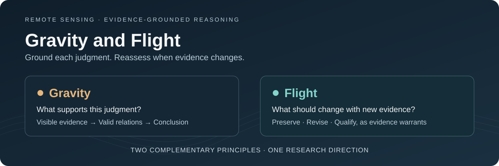

# Gravity and Flight

**Fine-Grained Evidence-Grounded Reasoning in Remote Sensing**

*Ground each judgment. Reassess when evidence changes.*

English · [中文](README_zh.md)

> This repository introduces the motivation and research direction of **Gravity and Flight (G&F)**. The manuscript has not yet been posted on arXiv; this public showcase presents the conceptual overview ahead of the full paper.

## 01 · Background

Vision-language models can recognize many objects and describe complex scenes. In remote sensing, however, recognizing visible elements is only part of understanding an image. Visually similar scenes may differ in function because of a few critical objects, their spatial relationships, or the way they are arranged.

Fine-grained harbor understanding illustrates this challenge. Ships, waterfront structures, storage areas, and industrial facilities can appear in several related environments. Their presence alone does not settle what a particular scene supports. Reliable interpretation requires connecting the relevant evidence to relationships, and those relationships to a justified conclusion.

## 02 · The problem we investigate

Our starting observation is that a capable model can produce a plausible answer while using the available visual evidence inconsistently. We focus on three recurring difficulties:

- **Premature conclusions.** Familiar objects can trigger a scene interpretation before the decisive relationships have been established.
- **Missed differences.** Highly similar scenes can invite the same explanation even when a small evidence change should alter the judgment.
- **Unclear judgment boundaries.** When an image leaves a key relationship unresolved, the answer may be more specific or certain than the evidence permits.

This motivates a question: **How can we organize existing visual capabilities into reasoning that follows fine-grained evidence reliably, including when the context changes?**

## 03 · The idea: Gravity and Flight

G&F explores two complementary principles for remote-sensing vision-language post-training.

| Principle | Guiding question | Intended behavior |
| :--- | :--- | :--- |
| **Gravity** | What in this image supports the judgment? | Anchor the conclusion in observable evidence and valid relationships. |
| **Flight** | What should remain, change, or become less certain in a related context? | Preserve relevant shared reasoning and reassess the judgment in response to decisive differences. |

The intuition is to learn both from an individual scene and from the relationship between closely related scenes. A useful comparison makes clear which evidence is shared and which change matters for the task. The appropriate response may be to preserve a conclusion, revise it, or qualify its certainty.

**Gravity keeps reasoning grounded. Flight helps it respond to change.** Together, they frame a research direction in which conclusions and confidence follow the evidence.

## 04 · Research goals

- **Strengthen evidence-grounded reasoning:** connect observations, spatial or functional relationships, and conclusions more reliably.
- **Distinguish similar scenes:** respond to task-relevant differences while retaining the reasoning that remains supported.
- **Calibrate judgment boundaries:** recognize when the image supports a specific conclusion and when a more qualified answer is appropriate.
- **Examine broader applicability:** use fine-grained harbor understanding as the primary setting and investigate the approach in additional remote-sensing contexts.

These are research goals; their effectiveness and scope will be assessed through experiments reported in the full paper.

---

*Current scope: project introduction. Method details, experimental results, and research artifacts are reserved for a later research release.*
