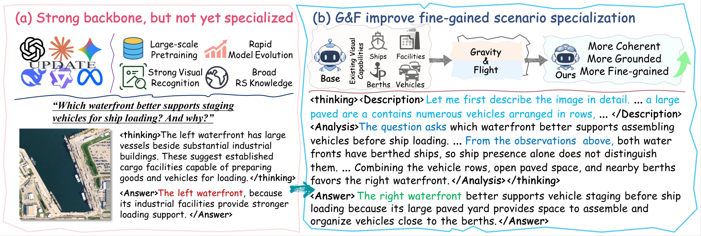
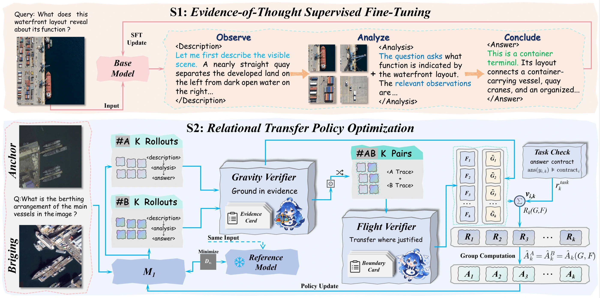
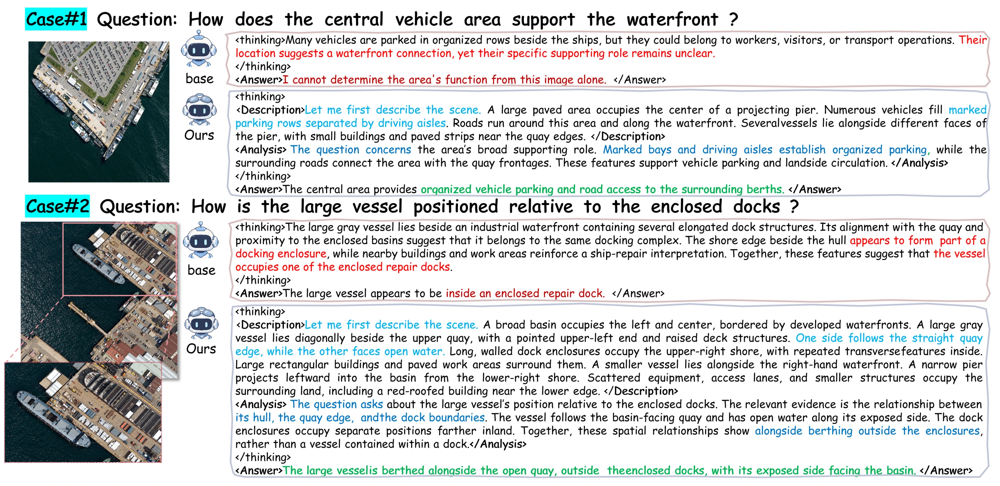
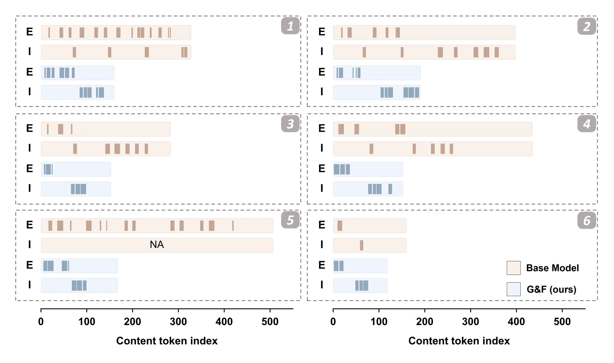

# Gravity & Flight

**Evidence-grounded reasoning for fine-grained remote sensing.**

[Website](https://z0ngl1ng.github.io/Gravity-and-Flight/) · [Research notes](docs/RESEARCH.md) · [Filling Before Advancing](https://github.com/Z0ngL1ng/filling-before-advancing) · [中文](README_zh.md)

Gravity and Flight (G&F) adapts **Qwen3.5-4B** through two stages of post-training. It teaches the model to connect detailed observations to task-specific judgments, then refine those judgments when the evidence changes.

*Recognizing ships and facilities is a starting point. This illustrative example asks the model to connect vehicle rows, paved space, and nearby berths to the task. Both waterfronts are in one input image.* [Original PDF](web/assets/papers/gf-motivation.pdf)

## Research idea

[Filling Before Advancing (FBA)](https://github.com/Z0ngL1ng/filling-before-advancing) develops capabilities for remote-sensing scenario specialization. Its second stage, **Bridging-Conv**, learns shared priors across target and related scenes. G&F takes that idea into finer contextual changes **within one scene domain**: which judgments should change, stay consistent, or become less specific as local attributes, spatial relations, and visibility vary?

Prior work: [Zong et al. (2026), *Filling Before Advancing*](https://arxiv.org/abs/2607.22205) · [Project website](https://z0ngl1ng.github.io/filling-before-advancing/) · [Hugging Face model preview](https://huggingface.co/zongling/FBA) · [Hugging Face dataset preview](https://huggingface.co/datasets/zongling/CPRS).

The name draws on gravity and aerodynamic lift. **Gravity** anchors visual claims to the image; **Flight** evaluates reasoning from described observations. The analogy motivates complementary verification, not a physical reward model.

## Method

*The complete method figure from the paper.* [Original PDF](web/assets/papers/gf-method.pdf)

1. **EoT-SFT** initializes a description → analysis → answer process with 1,008 harbor demonstrations covering 888 images.
2. **RTPO** refines this process using 500 Anchor–Bridging pairs under shared tasks. Responses are generated independently for each image, then randomly matched one-to-one for verification.

Gravity checks visual fidelity and descriptive coverage. Flight checks evidence use and justified adaptation across the pair. Task Check evaluates final-answer correctness. Their scores form an **additive pair reward and a shared advantage**; Gravity does not gate Flight. Flight does not inspect images or receive answer contracts. [Verification details](docs/RESEARCH.md#complementary-verification)

**Inference uses one image and one question.** Paired supervision and verification cards are training machinery, not policy inputs at deployment.

## Reported results

G&F reaches **69.12 Overall**, gaining **9.76 points over Base** and **4.56 points over EoT-SFT**.

| Checkpoint | Overall | Δ vs. Base |
| --- | ---: | ---: |
| Qwen3.5-4B Base | 59.36 | — |
| EoT-SFT | 64.56 | +5.20 |
| **G&F** | **69.12** | **+9.76** |

Overall is the unweighted mean of six harbor evaluation-set scores: HarborEval, VRSBench, RSVQA, OpenEval, OmniEarth, and VLRS-Bench. Each retains its own scoring protocol; this is a study-specific aggregate, not pooled accuracy or a full-benchmark leaderboard. [Full comparison, ablations, and separate urban study](docs/RESEARCH.md#harbor-evaluation)

<strong>Two qualitative cases</strong> — local evidence and spatial relations

These examples illustrate how local observations support a task-specific conclusion: organized vehicle parking and road access in the first case, and alongside berthing outside enclosed docks in the second. They are qualitative examples, not an aggregate accuracy estimate. [Original PDF](web/assets/papers/gf-qualitative-cases.pdf)

<strong>Six-case response analysis</strong> — evidence and inference token positions

**E** marks evidence tokens; **I** marks inference tokens. Warm rows show Base and cool rows show G&F. **NA** denotes a Base response with no analytical tokens, rather than zero inference density.

The horizontal axis counts content tokens, excluding format-only tokens. Across six sampled image–question cases, mean content length is **350.83 → 156.33 tokens**, and mean task-related content density is **22.35% → 39.91%**. This descriptive sample does not establish benchmark-wide efficiency or accuracy. [Analysis definitions](docs/RESEARCH.md#response-analysis) · [Original PDF](web/assets/papers/gf-token-analysis.pdf)

## Resources

- **Available:** the [project website](https://z0ngl1ng.github.io/Gravity-and-Flight/), [website source](web/), [research notes](docs/RESEARCH.md), and [four original paper figures](docs/FIGURES.md).
- **Not yet released:** the full manuscript, training/evaluation implementation, checkpoints, and datasets. Updates will appear in [release status](RELEASE_STATUS.md).

[Local website preview](docs/WEBSITE.md#view-the-website) · [Figure provenance](docs/FIGURES.md) · [License scope](LICENSE_SCOPE.md)
