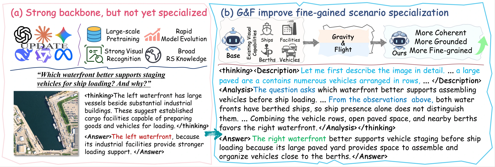
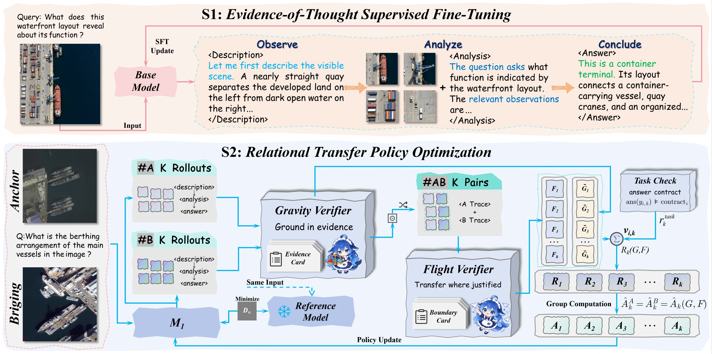
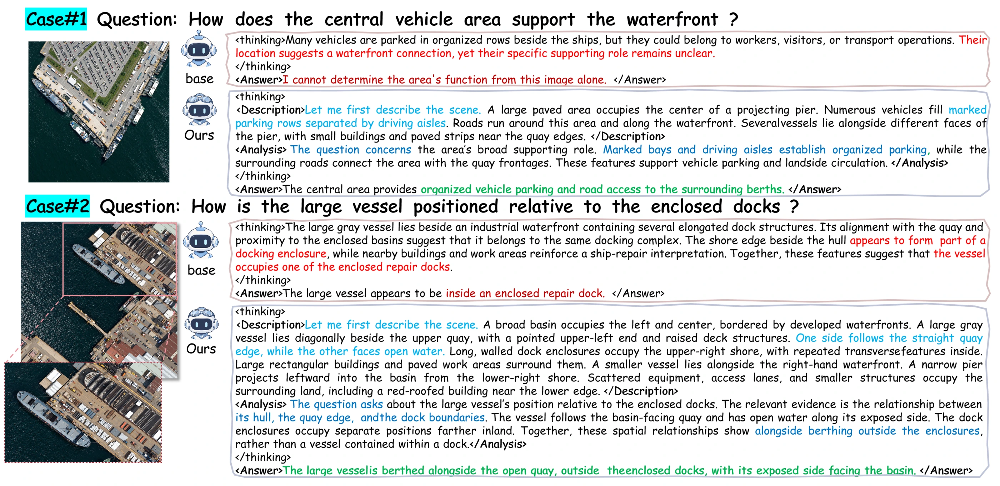
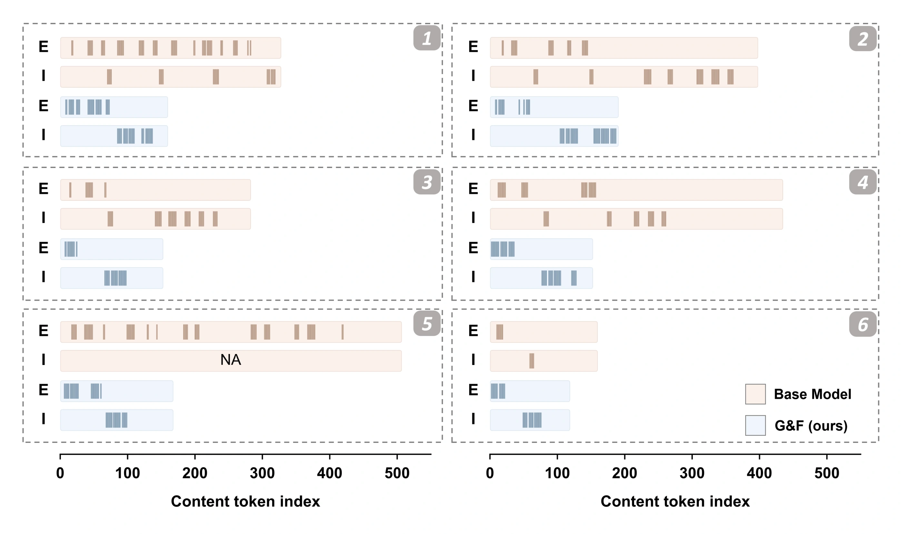

# Gravity & Flight

### 面向遥感视觉语言模型的细粒度证据化推理

<em>“飞行并非摆脱重力，而是与其约束相处的艺术。”</em>

  
  &nbsp;
  
  &nbsp;
  
  &nbsp;
  

<a href="README.md">English</a> · <strong>简体中文</strong>

<a href="#概览">概览</a> &nbsp;·&nbsp; <a href="#方法">方法</a> &nbsp;·&nbsp; <a href="#已报告结果">实验结果</a> &nbsp;·&nbsp; <a href="#资源">资源与样例</a>

*识别船舶与设施只是起点。这个示例要求模型把车辆排列、铺装空间和邻近泊位联系到任务；图中的两处岸线位于同一张输入图像中。* [原始 PDF](web/assets/papers/gf-motivation.pdf)

## 概览

Gravity and Flight（G&F）以 **Qwen3.5-4B** 为基座，通过两阶段后训练，让模型将细致观察连接到具体任务下的判断，并在证据变化时相应调整判断。

| 基座 | 监督规模 | Overall |
| :---: | :---: | :---: |
| **4B** Qwen3.5 单图推理 | **1,008 条示范** **500 对图像** 两个训练阶段 | **69.12** +9.76 相较 Base |

## 研究思路

[Filling Before Advancing（FBA）](https://github.com/Z0ngL1ng/filling-before-advancing) 建立遥感场景专精所需的能力，其第二阶段 **Bridging-Conv** 从目标场景与相关场景中学习共享先验。G&F 将这一思路推进到**同一场景领域内部**的细粒度上下文变化：当局部属性、空间关系或可见性改变，哪些判断应随之改变，哪些应保持一致，哪些应降低具体程度？

<strong>前作引用与资源 · Filling Before Advancing</strong>

[Zong 等（2026），*Filling Before Advancing*](https://arxiv.org/abs/2607.22205)

| 论文 | 项目 | 模型 | 数据集 |
| :---: | :---: | :---: | :---: |
| [arXiv](https://arxiv.org/abs/2607.22205) | [项目官网](https://z0ngl1ng.github.io/filling-before-advancing/) | [HF 预览](https://huggingface.co/zongling/FBA) | [CPRS 预览](https://huggingface.co/datasets/zongling/CPRS) |

命名灵感来自重力与气动升力。**Gravity** 让视觉陈述立足图像；**Flight** 检验推理如何从已描述的观察出发。这一类比启发了互补验证设计，不是奖励函数的物理模型。

## 方法

*论文中的完整方法图。* [原始 PDF](web/assets/papers/gf-method.pdf)

1. **EoT-SFT** 通过覆盖 888 张港口图像的 1,008 条示范，初始化“描述 → 分析 → 回答”的过程。
2. **RTPO** 使用共同任务下的 500 对 Anchor–Bridging 图像细化这一过程。每张图像独立生成回答，再随机一对一匹配，进行成对验证。

Gravity 检查视觉忠实性与描述覆盖度，Flight 检查证据使用及两侧判断的调整是否有据，Task Check 检查最终答案正确性。各项分数组成**相加的成对奖励与共享优势信号**；Gravity 不对 Flight 设置门控，Flight 不读取图像或答案约定。[验证定义](docs/RESEARCH.md#complementary-verification)

> **推理时只需一张图像与一个问题。** 成对监督与验证卡片用于训练，不是部署时的策略输入。

## 已报告结果

G&F 的 **Overall 为 69.12**，相较 **Base 提升 9.76 分**，相较 **EoT-SFT 再提升 4.56 分**。

| 模型阶段 | Overall | 相较 Base 提升 |
| --- | ---: | ---: |
| Qwen3.5-4B Base | 59.36 | — |
| EoT-SFT | 64.56 | +5.20 |
| 单图 RL | 65.12 | +5.76 |
| 成对 RL 无 F2 | 66.79 | +7.43 |
| **G&F** | **69.12** | **+9.76** |

Overall 是 HarborEval、VRSBench、RSVQA、OpenEval、OmniEarth 与 VLRS-Bench 六个港口评测集得分的等权均值。各集保留自身评分协议，因此这是本研究的汇总指标，不是合并准确率或完整基准排行榜。[完整比较、消融与独立城市场景实验](docs/RESEARCH.md#harbor-evaluation)

成对训练去掉 F2 后，相比单图 RL 提升 **1.67 分**；加入对应正确的 F2 反馈再提升 **2.33 分**。在每个训练单元的六个候选回答对之间打乱 F2 分数后为 **64.71**，联合输入 RL 为 **66.49**。完整 G&F 的实测训练墙钟时间为 Stage 1 的 **16.69×**，包含初始化和验证器等待。[全部对照与实测成本](docs/RESEARCH.md#ablations-and-controls)

<strong>验证器可靠性</strong> — 抽样 24 个训练单元

| 维度 | 条目数 | 与人工参考相差不超过 1 分（%） | 重复评分变化率（%） |
| --- | ---: | ---: | ---: |
| G1 | 48 | 91.67 | 22.92 |
| G2 | 48 | 100.00 | 12.50 |
| F1 | 48 | 89.58 | 27.08 |
| F2 | 24 | 83.33 | 29.17 |

抽样 24 个训练单元，两位标注者独立评分并裁决。符合率比较首次验证器评分与人工参考；变化率统计两次相同调用中任何分数变化。这一小样本审计反映评分可靠性，不构成对 rubric 本身的验证。 [审计协议](docs/RESEARCH.md#verifier-reliability)

<strong>两个定性案例</strong>：局部证据与空间关系

两个案例展示局部观察如何支撑具体结论：第一个案例关注有组织的车辆停放与道路通达，第二个案例区分封闭船坞内部与船坞外的沿岸靠泊。这些是定性示例，不是总体准确率估计。[原始 PDF](web/assets/papers/gf-qualitative-cases.pdf)

<strong>六案例回答分析</strong>：证据与推理 token 的位置

**E** 表示证据 token，**I** 表示推理 token；暖色对应 Base，冷色对应 G&F。**NA** 表示该条 Base 回答没有分析 token，不代表推理密度为零。

横轴按内容 token 计数，不含格式专用 token。在六个采样图像—问题案例中，平均内容长度为 **350.83 → 156.33 tokens**，平均任务相关内容密度为 **22.35% → 39.91%**。这项描述性分析不能用于推断整个基准的效率或准确率。[分析定义](docs/RESEARCH.md#response-analysis) · [原始 PDF](web/assets/papers/gf-token-analysis.pdf)

## 资源

| 资源 | 入口 | 当前状态 |
| --- | --- | --- |
| **项目官网** | [浏览 G&F](https://z0ngl1ng.github.io/Gravity-and-Flight/) | 研究脉络、论文插图与实验结果 |
| **4B 模型** | [Hugging Face 模型页](https://huggingface.co/zongling/Gravity_and_Flight-4B) | 已公开模型介绍 |
| **数据集样例** | [概览](https://huggingface.co/datasets/zongling/Gravity_and_Flight-2K) · [Stage 1](https://huggingface.co/datasets/zongling/Gravity_and_Flight-2K/tree/main/stage1) · [Stage 2](https://huggingface.co/datasets/zongling/Gravity_and_Flight-2K/tree/main/stage2) | 3 条示范 + 3 个图像对 |
| **研究说明** | [方法与已报告实验](docs/RESEARCH.md) | 定义、对照与适用范围 |
| **发布状态** | [查看资源开放进展](RELEASE_STATUS.md) | 资源状态与后续更新 |

**模型权重与完整数据集计划在论文中稿后逐步开放。** 完整论文、训练与评测实现尚未发布。

网站源码、插图来源与仓库文档

- [网站源码](web/)与[本地预览方法](docs/WEBSITE.md#view-the-website)
- [四幅原始论文插图及来源说明](docs/FIGURES.md)
- [授权范围](LICENSE_SCOPE.md)

