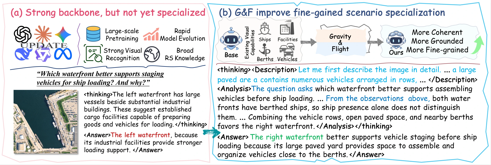
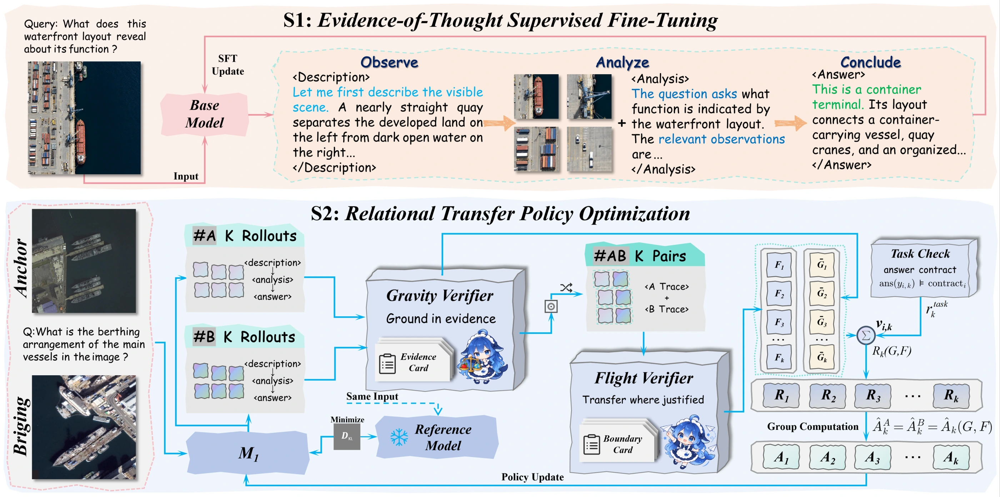

<div align="center">

# Gravity & Flight

### 面向遥感视觉语言模型的细粒度证据化推理

<p align="center"><em>“飞行并非摆脱重力，而是与其约束相处的艺术。”</em></p>

<p align="center">
  <a href="https://arxiv.org/abs/2611.16408"></a>
  &nbsp;
  <a href="https://z0ngl1ng.github.io/Gravity-and-Flight/web/"></a>
  &nbsp;
  <a href="https://huggingface.co/zongling/Gravity_and_Flight-4B"></a>
  &nbsp;
  <a href="https://huggingface.co/datasets/zongling/Gravity_and_Flight-2K"></a>
</p>

<p align="center"><a href="README.md">English</a> · <strong>简体中文</strong></p>

</div>

## 概览

Gravity and Flight（G&F）让 **Qwen3.5-4B** 将细致观察连接到具体任务下的判断，并在证据变化时相应调整判断。

[Filling Before Advancing（FBA）](https://github.com/Z0ngL1ng/filling-before-advancing) 建立遥感场景专精所需的能力，其第二阶段 **Bridging-Conv** 从目标场景与相关场景中学习共享先验。G&F 将这一思路推进到**同一场景领域内部**的细粒度上下文变化：当局部证据改变，哪些判断应随之改变，哪些应保持一致，哪些应降低具体程度？



*港口场景示例；两处岸线位于同一张输入图像中。*

## 方法



1. **EoT-SFT** 通过覆盖 888 张港口图像的 1,008 条示范，初始化“描述 → 分析 → 回答”的过程。
2. **RTPO** 使用共同任务下的 500 对 Anchor–Bridging 图像细化这一过程。每张图像独立生成回答，再随机一对一匹配，进行成对验证。

命名灵感来自重力与气动升力。**Gravity** 让视觉陈述立足图像；**Flight** 检查证据使用及两侧判断的调整是否有据；**Task Check** 检查最终答案正确性。[验证定义](docs/RESEARCH.md#complementary-verification)

> **推理时只需一张图像与一个问题。**

## 已报告结果

| 模型阶段 | Overall | 相较 Base 提升 |
| --- | ---: | ---: |
| Qwen3.5-4B Base | 59.36 | — |
| EoT-SFT | 64.56 | +5.20 |
| **G&F** | **69.12** | **+9.76** |

Overall 是六个港口评测集得分的等权均值。各集保留自身评分协议，因此这是本研究的汇总指标，不是合并准确率或完整基准排行榜。

## 资源

| 资源 | 入口 |
| --- | --- |
| **论文** | [Gravity and Flight: Learning to Navigate Fine-Grained Remote Sensing Scenes](https://arxiv.org/abs/2611.16408) |
| **研究说明** | [方法、已报告实验与适用范围](docs/RESEARCH.md) |
| **数据集样例** | [Stage 1](https://huggingface.co/datasets/zongling/Gravity_and_Flight-2K/tree/main/stage1) · [Stage 2](https://huggingface.co/datasets/zongling/Gravity_and_Flight-2K/tree/main/stage2) · 3 条示范 + 3 个图像对 |
| **发布状态** | [查看资源开放进展](RELEASE_STATUS.md) |
| **仓库文档** | [网站源码](web/) · [本地预览](docs/WEBSITE.md#view-the-website) · [论文插图](docs/FIGURES.md) · [授权范围](LICENSE_SCOPE.md) |

**模型权重与完整数据集计划在论文中稿后逐步开放。** 训练与评测代码尚未公开。

<details>
<summary><strong>前作引用与资源 · Filling Before Advancing</strong></summary>

Zong 等（2026），*Filling Before Advancing*。

| 论文 | 项目 | 模型 | 数据集 |
| :---: | :---: | :---: | :---: |
| [arXiv](https://arxiv.org/abs/2607.22205) | [项目官网](https://z0ngl1ng.github.io/filling-before-advancing/) | [HF 预览](https://huggingface.co/zongling/FBA) | [CPRS 预览](https://huggingface.co/datasets/zongling/CPRS) |

</details>

## 引用

FBA 与 G&F 构成面向遥感场景专精的系列工作。两篇论文的 BibTeX 引用如下。

### Filling Before Advancing (FBA)

```bibtex
@article{zong2026fba,
  title   = {Filling Before Advancing: Capability-Gap-Driven Post-Training for Scenario-Specialized Remote Sensing {MLLMs}},
  author  = {Zong, Yuheng and Wang, Minghua and Zhao, Xin and Zhan, Zhi-Hui and Plaza, Antonio and Benediktsson, Jon Atli},
  journal = {arXiv preprint arXiv:2607.22205},
  year    = {2026},
  doi     = {10.48550/arXiv.2607.22205},
  url     = {https://arxiv.org/abs/2607.22205}
}
```

### Gravity and Flight (G&F)

```bibtex
@article{zong2026gravityandflight,
  title   = {Gravity and Flight: Learning to Navigate Fine-Grained Remote Sensing Scenes},
  author  = {Zong, Yuheng and Wang, Minghua and Zhao, Xin and Liu, Xiaobin and Deng, Yongjian and Eom, Chanho},
  journal = {arXiv preprint arXiv:2611.16408},
  year    = {2026},
  doi     = {10.48550/arXiv.2611.16408},
  url     = {https://arxiv.org/abs/2611.16408}
}
```
