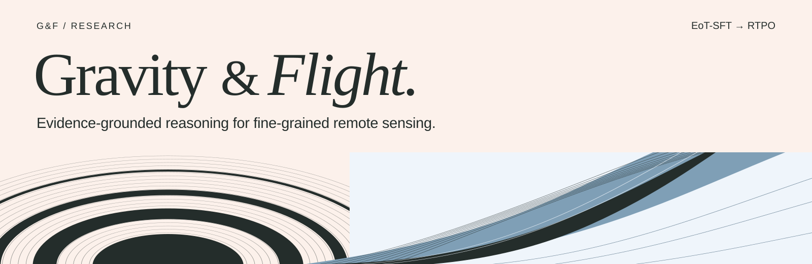
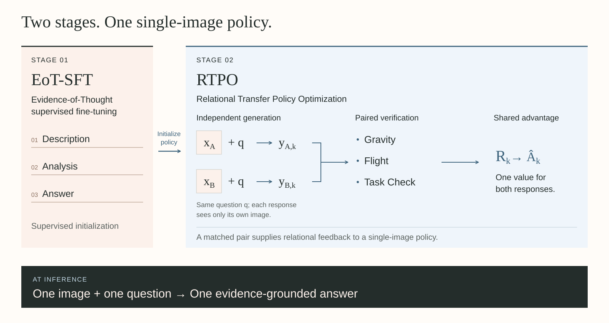

<div align="center">

# Gravity & Flight

**面向遥感视觉语言模型的细粒度证据化推理**

*让判断有据，让推理随证据变化。*

[项目网站](https://z0ngl1ng.github.io/Gravity-and-Flight/) · [研究说明](docs/RESEARCH.md) · [发布状态](RELEASE_STATUS.md) · [English](README.md)

</div>



**Gravity and Flight（G&F）** 是一个两阶段后训练框架，旨在让视觉语言模型将细致观察连接到具体任务下的判断。相关场景提供进一步的学习信号：哪些判断应保持一致，哪些应随证据改变，哪些应在支持不足时降低具体程度。

本公开仓库提供项目网站、方法概览与部分已报告的研究结果。**[访问已上线的网站 →](https://z0ngl1ng.github.io/Gravity-and-Flight/)** 完整论文、训练与评测实现、模型权重及数据集尚未在本仓库发布，具体见[资源状态表](RELEASE_STATUS.md)。

## 从场景间迁移，到场景内迁移

研究起点来自 [Filling Before Advancing（FBA）](https://github.com/Z0ngL1ng/filling-before-advancing)。FBA 的第二阶段 **Bridging-Conv** 从目标场景与相关场景中学习共享先验。这启发我们进一步追问：**在同一场景领域中，当局部属性、空间关系或可见性变化，判断应当如何随之调整？**

G&F 通过**共同任务下的 Anchor–Bridging 图像对**将这一问题具体化。每张图像独立生成回答，再以成对反馈评估两侧判断之间的关系。图像对可以由两张不同的港口图像组成，并不要求同一地理位置或时序变化。G&F 从 **Qwen3.5-4B** 出发，依次进行 EoT-SFT 与 RTPO 训练。

命名灵感来自飞行中重力与气动升力的共同作用。**Gravity** 让视觉陈述立足图像；**Flight** 检验推理如何从已描述的观察出发。这是互补验证设计的概念性启发，不是训练目标的物理模型。

## 两个训练阶段，一个单图策略



| 阶段 | 学习目标 | 港口监督规模 |
| --- | --- | ---: |
| **1 · EoT-SFT** | 通过 Evidence-of-Thought 示范连接场景描述、任务分析与有依据的答案。 | 1,008 条示范，覆盖 888 张图像 |
| **2 · RTPO** | 通过 Relational Transfer Policy Optimization，在任务匹配的场景间细化证据使用方式。 | 500 对图像，包含 1,000 张不同图像 |

RTPO 独立采样回答，进行一对一匹配，并组合三项检验：

| 检验 | 评估内容 |
| --- | --- |
| **Gravity** | 结合图像与 Evidence Card，检查回答各部分的视觉忠实性，以及初始描述的观察覆盖度。 |
| **Flight** | 检查单条回答中的证据使用，以及两侧判断的一致、改变或降低具体程度是否有据可依。它有条件地接受已描述的前提，不读取图像或 Evidence Card。 |
| **Task Check** | 按各侧的答案约定检查最终答案正确性。 |

各项分数组成相加的成对奖励，再将同一个组内归一化优势信号分配给两侧回答，两侧损失等权。**推理时，策略只需一张图像与一个问题。** 验证卡片仅用于训练监督，不进入策略输入。[查看方法说明 →](docs/RESEARCH.md)

## 已报告的港口实验结果

主要实验以 Qwen3.5-4B 为基座。EoT-SFT 提升了 Overall 得分，RTPO 在该监督初始化之上进一步带来 **4.56 分**的提升。

| 训练状态 | Overall | 相较 Base 提升 |
| --- | ---: | ---: |
| Qwen3.5-4B Base | 59.36 | — |
| 阶段一 · EoT-SFT | 64.56 | +5.20 |
| **G&F · EoT-SFT + RTPO** | **69.12** | **+9.76** |

| 模型 | HarborEval | VRSBench | RSVQA | OpenEval | OmniEarth | VLRS-Bench |
| --- | ---: | ---: | ---: | ---: | ---: | ---: |
| Qwen3.5-4B Base | 73.15 | 37.21 | 58.69 | 67.34 | 80.39 | 39.39 |
| **G&F** | **82.57** | **54.19** | **67.18** | **82.07** | **80.99** | **47.73** |

**请结合评测范围解读。** Overall 是六个港口评测集分数在 0–100 标度上的等权均值。各评测集保留自身评分协议，因此它不是合并准确率，也不代表完整基准的排行榜。G&F 在六项评测中均优于其基座；更广的模型比较中，RSThinker 的 VRSBench 得分仍更高。研究未报告 Stage 1 的逐项分数。这里展示的是研究稿中报告的结果，评测实现不属于本次公开内容。

[研究说明](docs/RESEARCH.md) 还列出奖励消融与匹配对照：**移除 Flight 为 65.11**、**移除 Gravity 为 66.32**、**单图 RL 为 65.12**、**联合输入 RL 为 66.49**，均为 Overall 分数。

## 主实验之外

- **独立的城市场景专精。** 城市模型使用 160 条示范与 60 对训练图像完成两阶段训练，相较城市 Stage 1，在固定的 EarthVQA Urban、VRSBench Urban 和 RSVQA HR 子集上分别提升 **1.93 / 2.08 / 4.67 分**。该实验考察框架复用，并非港口模型的零样本迁移。
- **六组采样回答的内部变化。** 平均完整回答长度为 **355.50 → 179.50 tokens**，平均任务相关内容密度为 **22.35% → 39.91%**。这是一项覆盖六个图像—问题案例的描述性分析，每个模型在每个案例上各生成一条回答，不能据此推断整个基准的效率或准确率。

## 浏览仓库

| 路径 | 内容 |
| --- | --- |
| [`web/`](web/) | 双语静态网站、可切换的评测对比、本地字体与原创插图 |
| [`assets/`](assets/) | 仓库封面与方法概览图 |
| [`docs/RESEARCH.md`](docs/RESEARCH.md) | 公开的方法说明、已报告表格及解读范围 |
| [`docs/WEBSITE.md`](docs/WEBSITE.md) | 网站上线状态与本地预览说明 |
| [`RELEASE_STATUS.md`](RELEASE_STATUS.md) | 论文、代码、权重与数据的可用状态 |
| [`LICENSE_SCOPE.md`](LICENSE_SCOPE.md) | 使用权限范围与第三方素材许可证 |

在仓库根目录运行以下命令，即可预览网站：

```sh
python3 -m http.server 8765
```

打开 [localhost:8765/web/](http://localhost:8765/web/)。无需构建步骤、模型下载、GPU 或 API 密钥。关闭 JavaScript 仍可阅读主要英文内容；JavaScript 提供中文切换、证据关系选项卡与评测项选择。

后续资源发布及论文链接将记录在 [RELEASE_STATUS.md](RELEASE_STATUS.md)。
